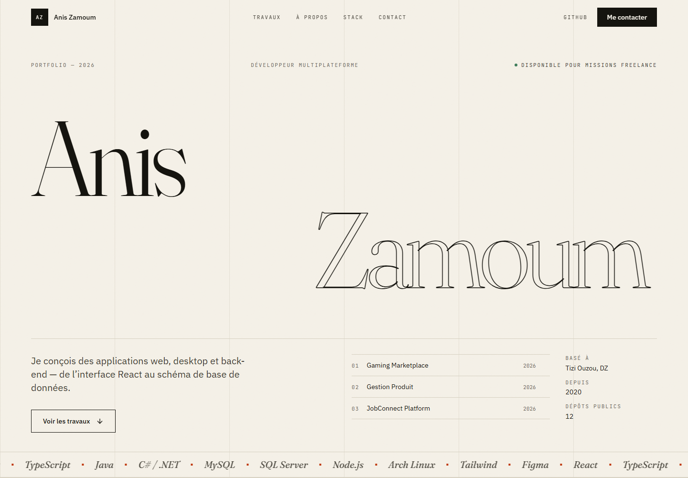

# Portfolio — Anis Zamoum

Portfolio personnel en une page : projets tirés du compte GitHub [@aniszeyy](https://github.com/aniszeyy), design éditorial, animations au scroll et filtres par plateforme.



## Stack

- React 19 + TypeScript
- Vite 7
- Tailwind CSS 3 (tokens maison, pas de bibliothèque de composants)
- Fraunces (titres), IBM Plex Sans (texte), JetBrains Mono (labels)
- Lucide pour les icônes

## Démarrage

```bash
npm install
npm run dev        # http://localhost:5173
npm run build      # dist/
npm run preview
```

## Contenu

Tout le texte et la liste des projets sont dans [`src/config.ts`](src/config.ts) : une seule source de vérité, aucun composant à modifier pour ajouter un projet.

| Section | Composant |
|---|---|
| Hero | `src/sections/Hero.tsx` |
| Travaux + filtres + forks | `src/sections/Work.tsx` |
| À propos | `src/sections/About.tsx` |
| Stack | `src/sections/Stack.tsx` |
| Contact | `src/sections/Contact.tsx` |

### Projets

10 projets sont présentés sur les 12 dépôts publics :

- 5 projets originaux : Gaming Marketplace, Gestion Produit, JobConnect Platform, les quatre jeux Java, ce portfolio.
- 5 forks / contributions : PFE Chirurgie, opencode, openclaw, system_prompts_leaks, AutoEcole.
- Les dépôts `aniszeyy` (README de profil) et `Test` (vide) ne sont pas listés.

Chaque carte pointe vers `github.com/aniszeyy/<dépôt>`.

## Déploiement — GitHub Pages

Chaque push sur `main` déclenche [`.github/workflows/deploy.yml`](.github/workflows/deploy.yml) : installation, build Vite, puis publication de `dist/` via GitHub Actions.

Le dépôt doit avoir **Settings → Pages → Source : GitHub Actions** (déjà configuré pour `aniszeyy.github.io`).

```bash
npm run build   # vérification locale avant push
```

`base` vaut `'./'` dans `vite.config.ts` : le build fonctionne aussi depuis un sous-dossier.

## Choix de design, d'accessibilité et de performance

Voir [DESIGN.md](DESIGN.md).